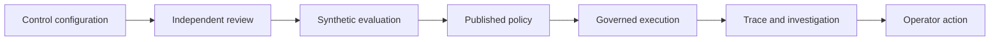

# AI governance and operational observability

A focused Nexus One AI workstream connecting policy configuration, independent review, evaluation and operational investigation.

**Scope:** Deployed and verified in a development environment; platform-wide governance is an ongoing program.

## The problem

Policy controls become difficult to trust when configuration, review, model execution and investigation are disconnected. Operators need to understand both the decision and the evidence behind it.

## My contribution

- Shaped the governance workflow from reusable detectors and groups through policy review, testing and investigation.
- Defined the need for traceability between incoming requests, processing jobs, model attempts and inspection decisions.
- Directed operator-facing alert workflows and impact previews using synthetic test cases.
- Used role checks, real workflow completion and responsive UI validation as acceptance criteria.

## Architecture decisions

**Review before activation.** Independent review and versioned dependencies make changes easier to assess and explain.

**Separate operational records.** Requests, jobs, model attempts and inspections answer different questions; treating them as one counter would obscure failures and coverage.

**Synthetic policy evaluation.** Before/after comparisons use retained synthetic cases rather than replaying confidential user content. Preview coverage must be stated explicitly.

## Conceptual architecture

This illustration describes functional boundaries, not a deployment topology.

## Delivery and outcome

Validated workflows include credential lifecycle operations, policy review, saved tests, correlated request investigation, in-app alert assignment and resolution, and policy impact preview. Coverage is bounded to supported application paths. Token accounting is not presented as monetary billing, and controls are not described as compliance certification.

## Technology context

Python services, policy evaluation, role-based access, audit metadata, local model integration, shared web UI components and automated workflow checks.

[Parent platform: Nexus One AI](nexus-one-ai.md)

[Back to portfolio](README.md)
