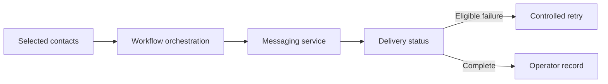

# Business automation and communications

Integration across marketing, messaging, contact management and support workflows.

**Scope:** Configured workflows and operational support, with scope varying by integration.

## The problem

Disconnected campaign, contact and messaging tools create repeated manual work and unclear delivery state.

## Architecture and leadership contribution

- Designed and configured contact imports, segmentation, campaign and form workflows.
- Connected communication platforms and investigated message delivery behavior.
- Worked on n8n orchestration with delivery checks and controlled retry handling.
- Prepared operating guides and training material; supported collaboration integrations involving Nextcloud and Zoho services.

## Architecture decisions

**Retry only eligible failures.** Delivery status should guide retry decisions so successful actions are not repeated unnecessarily.

**Separate orchestration from transport.** Workflow logic, communication delivery and operator support serve different responsibilities and need independent diagnostics.

**Design for the operator.** Configuration, training and recovery guidance are part of a usable integration.

## Conceptual architecture

This illustration describes functional boundaries, not a deployment topology.

## Delivery and outcome

The work produced connected campaign and messaging workflows, delivery troubleshooting and operational guidance. Social publishing support also included service-recovery work. The portfolio does not claim authorship of the underlying communication platforms.

## Platform landscape

Mautic, n8n, Chatwoot, Twilio, WhatsApp APIs, Zammad, Postiz, Nextcloud, Zoho, webhooks and REST APIs.

## Lead Intelligence and outreach integration

Lead Engine work connected lead intake and contact normalization to campaign handoff, segmentation and delivery state. My architecture contribution centered on service separation, integration responsibilities and migration planning across the custom intake layer and established campaign tools.

The history includes a deployed stack, contact handoff and operational migration/recovery work. These are integration outcomes, not claims of a proprietary marketing platform, guaranteed data quality or outreach results. Contact databases and campaign configurations remain private.

[Back to portfolio](README.md)
