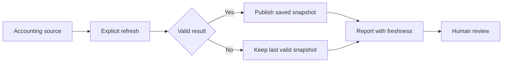

# Resilient accounting integration

A Cosmos workstream improving the reliability and interpretability of reports sourced from an external accounting system.

**Scope:** Deployed integration and bill-review improvements with bounded validation.

## The problem

A business report can become unusable if every page load depends on a reachable accounting service. A failed refresh must also not replace valid financial information with empty or misleading results.

## Architecture and leadership contribution

- Defined report behavior when the accounting dependency is slow or unavailable.
- Contributed to validated refresh and saved-snapshot workflows with visible freshness.
- Refined the distinction between outstanding references, purchase values and bill-matching actions.
- Verified representative review flows and report responses after delivery.

## Architecture decisions

**Retain the last valid snapshot.** Publish refreshed data only after validation, preserving the previous usable result when refresh fails.

**Show freshness.** A saved report needs a timestamp and status so users understand the age of the data they are reviewing.

**Separate comparison from posting.** Read-only reconciliation and human review should remain distinct from actions that change financial records.

## Conceptual architecture

This illustration describes functional boundaries, not a deployment topology.

## Delivery and outcome

Reporting gained validated saved-data behavior and clearer review/matching screens. Recent checks exercised failure retention, mappings and report rendering. End-to-end scheduling remains a separate operational check from an individual successful refresh.

## Platform landscape

Tally integration, MySQL, REST/XML interfaces, snapshot validation and financial reporting.

[Parent platform: Cosmos](cosmos-operations.md)

[Back to portfolio](README.md)
