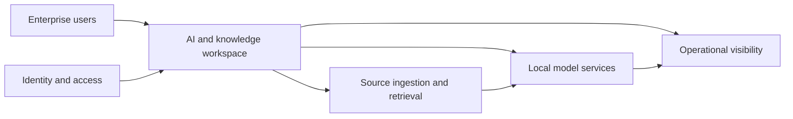

# Nexus One AI private AI platform

Architecture and integration of an enterprise AI workspace combining local model access, knowledge workflows and administrative controls.

**Scope:** Development deployments, selected workflow validation and pilot preparation.

## The problem

An organization needs more than a model endpoint: users need controlled access to knowledge, administrators need visibility, and operators need a platform they can deploy and recover.

## My contribution

- Contributed to the platform architecture and phased delivery plan across inference, identity, knowledge services and operations.
- Defined integration and environment boundaries, with development/testing separated from customer pilot preparation.
- Directed workspace usability improvements and validation for prompt, translation and source-grounded knowledge workflows.
- Prepared technical explanations and product material that connect platform capabilities to deployment requirements.

## Architecture decisions

**Local inference with explicit dependencies.** Model serving, document processing, identity and the user workspace are separate responsibilities. Restricted-connectivity deployment needs verification across that complete dependency chain.

**Knowledge with provenance.** Source-grounded answers should let users inspect the supporting source. Document ingestion and retrieval are treated as part of the user workflow, not just a model capability.

**Consistent workspaces.** Shared navigation and interaction patterns make administration and knowledge work easier to learn while keeping task-specific controls in the working area.

## Conceptual architecture

This illustration describes functional boundaries, not a deployment topology.

## Delivery and outcome

Recent development validation covered prompt generation, template workflows, text and text-file translation, and Notebook queries with citations. Shared interface components and responsive priority workspaces were delivered. Broader workspace migration and customer acceptance remain separate stages; this case study does not claim a universally air-gapped or certified deployment.

## Technology context

Linux, Docker, Kubernetes, GPU/CPU inference, Ollama, OpenWebUI, Python, REST APIs, retrieval-augmented generation, SSO/OIDC and data services.

[Explore the AI governance workstream](ai-governance.md) · [Platform delivery approach](platform-delivery.md)

[Back to portfolio](README.md)
