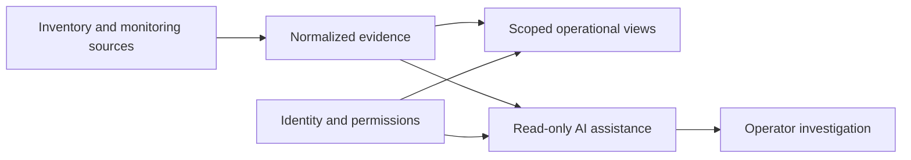

# Vantage AI network intelligence

An integrated operational view across network inventory, monitoring, security evidence and local AI-assisted investigation.

**Scope:** Linux pilot with verified investigation improvements; broader endpoint qualification is staged.

## The problem

Operators must reconcile observations from multiple tools. Stale records, inconsistent device identities and ambiguous failures can produce misleading conclusions unless the system preserves context.

## Architecture and leadership contribution

- Defined phased architecture spanning discovery, inventory, endpoint evidence, identity and investigation.
- Defined requirements for source provenance, evidence freshness, site scope and role-aware access.
- Directed reliability work around endpoint reporting, service continuity and recovery verification.
- Developed the investigation approach around supporting evidence, counter-evidence and useful next checks.

## Architecture decisions

**Evidence before diagnosis.** A current observation and a historical failure are different facts. The investigation should preserve uncertainty when the available evidence cannot establish a cause.

**Read-only assistance.** The assistant works within caller-authorized evidence. Remediation is a distinct capability requiring separate controls and validation.

**Qualify by platform.** Linux pilot results do not establish native Windows or macOS behavior; each operating system needs its own service and recovery checks.

## Conceptual architecture

This illustration describes functional boundaries, not a deployment topology.

## Delivery and outcome

The pilot gained structured reporting-cause assessments with evidence, limitations and distinguishing next checks, verified through automated checks and the signed-in interface. Endpoint recovery and service continuity were also exercised in controlled work. Symptom-time correlation, shared-cause analysis and approved remediation remain follow-on work.

## Platform landscape

Inventory, monitoring and security integration using NetBox, LibreNMS, Wazuh and Grafana; Keycloak identity, containerized services, data platforms and local inference with Ollama.

[Back to portfolio](README.md)
